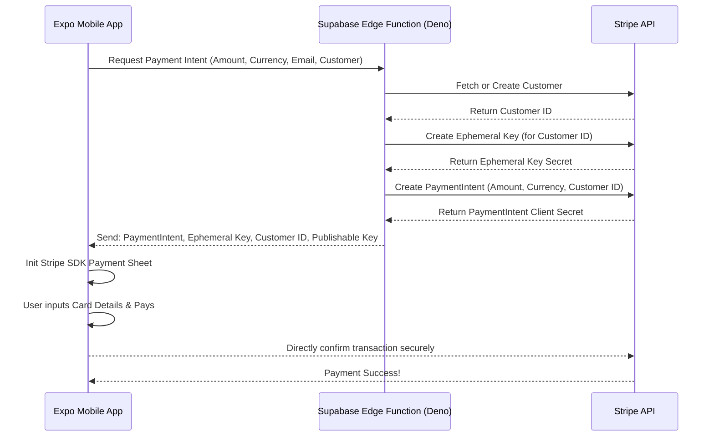

# 🛍️ Stripe & Supabase E-Commerce App (Expo)

Welcome to **eCommerce App with Stripe**, a premium, full-featured mobile e-commerce application built with **React Native (Expo)**, powered by a **Supabase** backend, and integrated with **Stripe Payment Gateway** for secure checkout.

This project showcases a modern shopping experience, leveraging global state management with Redux, Supabase database + authentication, and Supabase Deno Edge Functions to safely process transactions using Stripe's native Payment Sheet.

---

## 🚀 Key Features

*   **🔐 Supabase Authentication**: Secure signup, login, password recovery, and automatic session persistence.
*   **🛒 Shopping Cart & Wishlist**: Real-time state management using **Redux Toolkit** for smooth cart updates, quantity management, and wishlist operations.
*   **📱 Native Stripe Payment Sheet**: Integrates `@stripe/stripe-react-native` to load a premium, secure, and native payment flow inside iOS and Android.
*   **⚡ Serverless Payment backend**: Supabase **Deno Edge Functions** act as the secure backend to interface with Stripe (checking/creating customers, generating ephemeral keys, and preparing Payment Intents).
*   **✨ Dynamic Storefront**: Explore products, search/filter, and view product details seamlessly.

---

## 🛠️ Tech Stack

*   **Frontend**: React Native, Expo SDK 54, Expo Router (File-based Routing)
*   **State Management**: Redux Toolkit, React Redux
*   **Backend**: Supabase (Database, Auth, Edge Functions)
*   **Payment Gateway**: Stripe SDK for React Native
*   **Icons & UI**: Lucide Icons, Expo Vector Icons

---

## 📂 Project Structure

```text
├── app/                       # Expo Router application entry
│   ├── (auth)/                # Authentication screens (Login, Signup, Forgot Password)
│   ├── (tabs)/                # Main bottom navigation tabs (Home, Explore, Cart, Wishlist, Profile)
│   ├── checkout/              # Checkout & payment processing screens
│   ├── product/               # Product details page
│   ├── orders/                # Order history page
│   └── _layout.tsx            # App root layout containing Stripe & Redux providers
├── components/                # Reusable UI components (Buttons, Cards, Inputs, Loaders)
├── redux/                     # Redux Toolkit store, hooks, and slices (auth, cart, etc.)
├── services/                  # External services (Supabase Client connection)
├── supabase/                  # Supabase configurations & backend code
│   └── functions/             # Serverless Deno Edge Functions
│       └── create-payment-intent/
│           └── index.ts       # Secure server-side Stripe transaction helper
└── .env                       # Local environment variables configuration file
```

---

## ⚡ Setup & Installation

Follow these steps to set up and run the project locally.

### 1. Prerequisites
Make sure you have installed:
*   [Node.js](https://nodejs.org/) (v18+)
*   [Expo Go](https://expo.dev/go) app on your mobile device (or an Android Emulator / iOS Simulator)
*   [Deno CLI](https://deno.land/) (Optional, for editing/linting Supabase Edge Functions in VS Code)
*   [Supabase CLI](https://supabase.com/docs/guides/cli) (For local testing of Edge Functions)

---

### 2. Clone and Install Dependencies
Install all the frontend NPM packages:
```bash
npm install
```

---

### 3. Environment Variables Configuration
Create a `.env` file in the root directory (or update the existing one) with your credentials:

```ini
# Supabase Configs
EXPO_PUBLIC_SUPABASE_URL=https://your-supabase-project-id.supabase.co
EXPO_PUBLIC_SUPABASE_ANON_KEY=your-supabase-anon-key

# Supabase Edge Functions URL
EXPO_PUBLIC_SUPABASE_FUNCTIONS_URL=https://your-supabase-project-id.supabase.co/functions/v1

# Stripe Configs (TEST MODE)
EXPO_PUBLIC_STRIPE_PUBLISHABLE_KEY=pk_test_your_stripe_publishable_key
```

---

### 4. Supabase Backend Setup

#### A. Stripe Secret Key in Supabase
Deploy your Stripe secret API key safely into Supabase Secrets so the Edge Functions can read it:
```bash
supabase secrets set STRIPE_SECRET_KEY="sk_test_your_secret_key"
supabase secrets set STRIPE_PUBLISHABLE_KEY="pk_test_your_publishable_key"
```

#### B. Deploy the Edge Function
Deploy the payment processing Edge Function directly to your Supabase project:
```bash
supabase functions deploy create-payment-intent
```

---

### 5. Start the Application

Start the Expo bundler:
```bash
npm run start
```

Press:
*   `a` to open in the **Android Emulator**.
*   `i` to open in the **iOS Simulator**.
*   Scan the QR code with your camera/Expo Go app on your physical iOS or Android phone to test on a physical device.

---

## 💳 How the Payment Flow Works



1.  **Trigger**: The user taps **"Checkout" / "Pay Now"** in the mobile app.
2.  **Edge Function Call**: The app makes an HTTP request to `create-payment-intent` passing payment details (like amount, email, etc.) along with the user's authorization header.
3.  **Customer Resolver**: The backend checks Stripe to see if a customer with this email already exists. If not, it creates a new customer.
4.  **Ephemeral Key**: An Ephemeral Key is created, giving the mobile SDK temporary restricted access to fetch and show saved payment methods for that specific customer safely.
5.  **Payment Intent**: Stripe returns a `client_secret` for the Payment Intent.
6.  **Presentation**: The app passes this information to the native Stripe Sheet, which opens a beautifully formatted, secure input window.
7.  **Finalization**: The user enters their payment details, Stripe completes the validation securely, and the transaction concludes successfully.

---

## 🔒 Security Best Practices
*   **Zero Secret Leakage**: The Stripe Secret Key (`sk_test_...`) is **never** embedded in the frontend bundle. It is saved in Supabase Secrets and accessed only server-side within the Edge Function.
*   **PCI-DSS Compliance**: No card details ever touch the Supabase database. The Expo Stripe SDK securely handles credit card tokenization directly through Stripe's certified servers.
